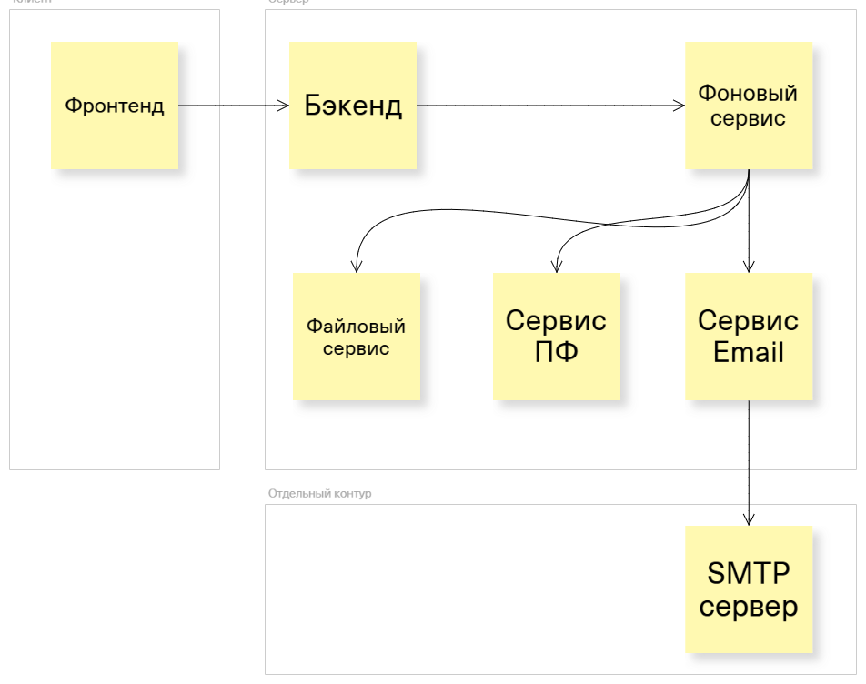
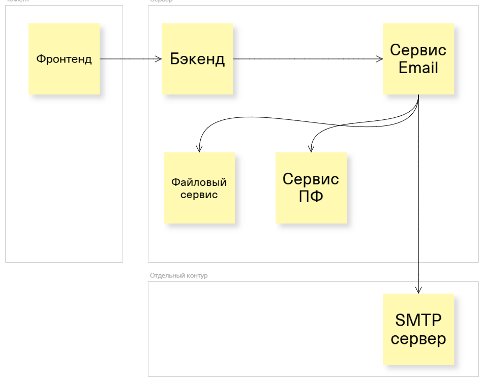
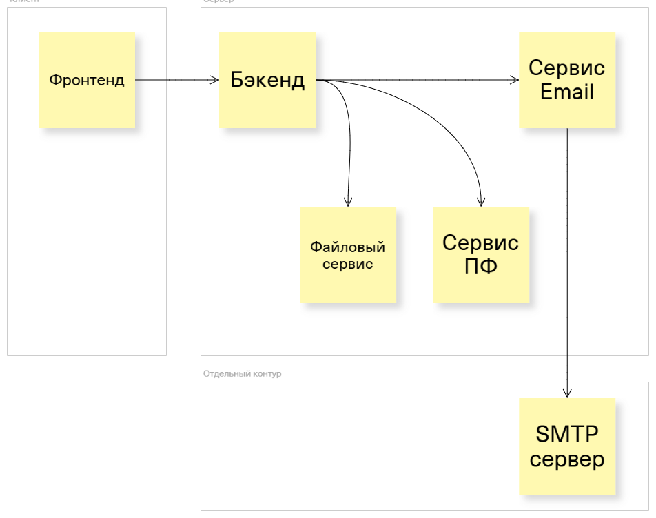

# Модуль отправки электронной почты

* Дата создания: 2025-04-08
* Дата обновления: 2025-04-15
* Версия: 1.0
* Статус: Реализовано

## Архитектурное решение

Модуль отправки электронной почты разбит на несколько независимых уровней:

1. Контракты сообщений — описывают запрос на отправку, подготовленное письмо и результат.
2. Предобработка — получает вложения из файлового сервиса и при необходимости формирует печатные формы.
3. Транспорт SMTP — отправляет уже подготовленное письмо.
4. Исполняемый сервис отправки почты — принимает подготовленные запросы из шины сообщений и возвращает результат.

Такое разделение позволяет клиенту формировать запрос без знания SMTP и без самостоятельной загрузки вложений.

## Основные потоки

Обычное письмо:
запрос на отправку → подготовка вложений → подготовленное письмо → сервис отправки → SMTP → результат.

Письмо с печатной формой:
запрос на отправку с печатной формой → сервис отчётов → подготовка вложений → подготовленное письмо → сервис отправки.

## Технологические границы

Модели находятся в `Tmobis.Integrations.Email`, обработка — в `.UseCases`, работа с отчетами — в `.Reports*`, SMTP-адаптер — в `.Sender.MailKit`, исполняемый сервис — в `.Service`.

Возможна разная архитектура сервисов в зависимости от компоновки модулей между сервисами системы (эталонная схема - №1):
- 
- 
- 

## Открытые вопросы

* контракт возврата результата вызывающему компоненту;
* отложенная отправка.
